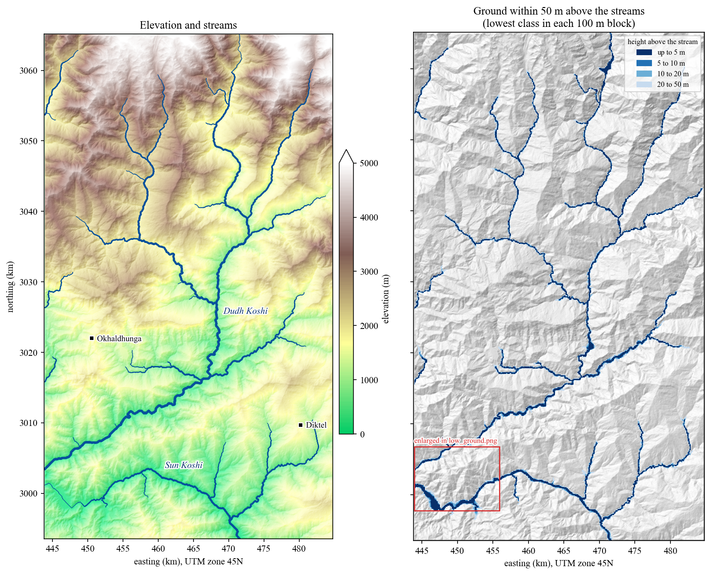
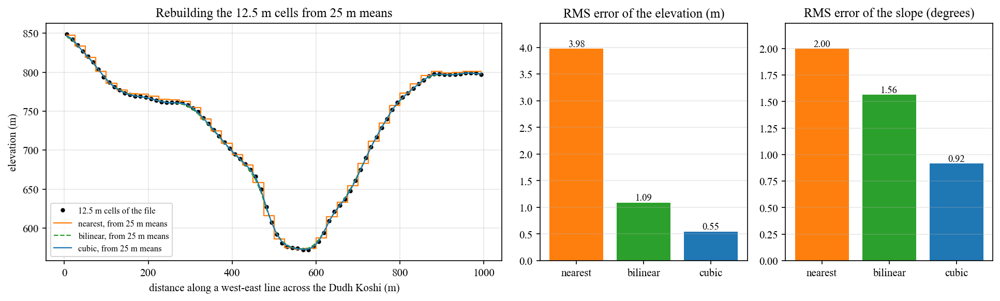
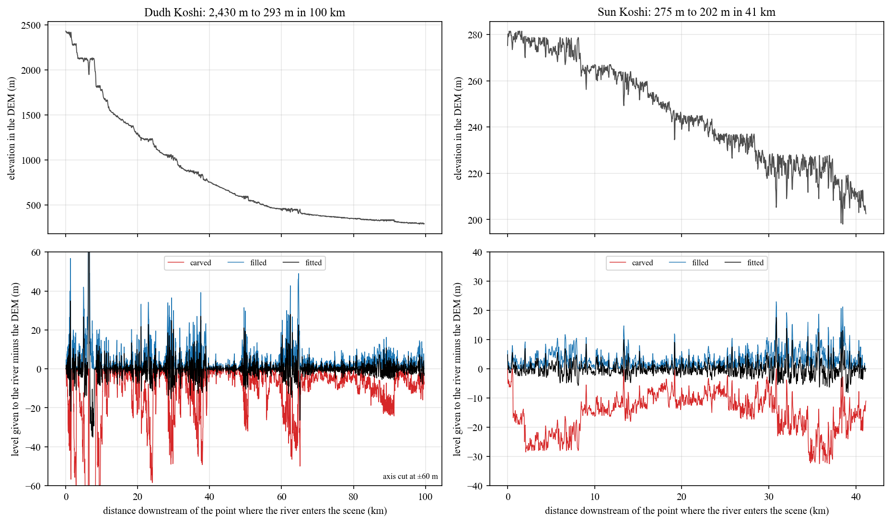
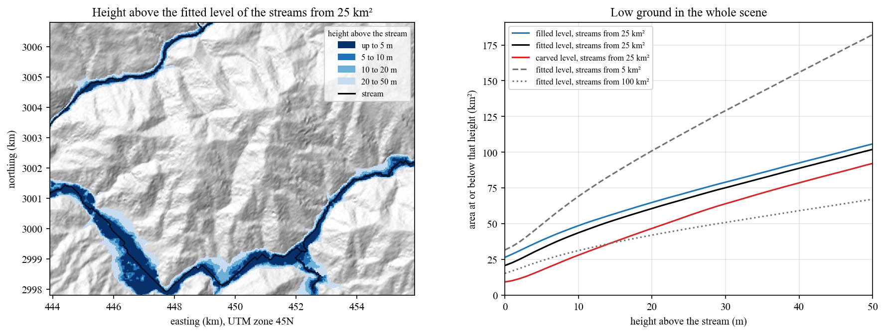

# Flood-prone ground from an elevation model, and checks of the rainfall and flood tables

Python code in two parts. The first takes the elevation model in this repository, a scene of
41 km by 72 km in eastern Nepal crossed by the Dudh Koshi and the Sun Koshi, and maps the
ground that lies within a few metres above the level of the streams. The second checks the
daily rainfall table and the flood-event table that came with the first version of the project.

No flood is predicted. The checks show that the two tables are generated data, and a model
fitted to them would describe how they were made. The terrain part is a screening of where low
ground lies along the rivers, with a measure of how far the elevation model supports it.



## Data and its limits

**Elevation model.** `AP_27418_PLR_F0540_RT1/AP_27418_PLR_F0540_RT1/AP_27418_PLR_F0540_RT1.dem.tif`
came with an ALOS PALSAR radar scene of 18 March 2011 that the Alaska Satellite Facility
corrected for terrain (ASF DAAC, 2014). The metadata of the product say what the file is: the
SRTM elevation model of 30 m resolution (SRTMGL1), "oversampled" to the 12.5 m cells of the
radar product. It follows that:

- the cells are 12.5 m but the detail is that of 30 m data, recorded by a radar in February 2000
  and stored in whole metres;
- the metadata do not state the vertical datum. The analysis uses only differences of height
  over short distances, which a shift of the datum does not change;
- the grid has 3281 x 5729 cells in UTM zone 45N and 2,921 km² with data, from 86.43 to 86.85 °E
  and from 27.06 to 27.71 °N, with elevations from 189 to 5806 m.

Only this file of 36 MB is used; the other 13 files of the product (276 MB) are the radar
images and what belongs to them. The product's metadata (`.iso.xml`) carry conditions of use,
among them that the data are not passed on to other parties. Check the current terms of the
Alaska Satellite Facility before publishing the repository with the scene in it.

The two rivers are named from their position. The first leaves the scene at 86.434 °E,
27.152 °N, 0.3 km from the coordinates given for the mouth of the Dudh Koshi in the Sun Koshi
(27°08′58″N 86°26′00″E; Wikipedia); the second enters about 2 km south of that point and flows
east. Okhaldhunga and Diktel are marked on the map at approximate positions.

**Rainfall table.** `Rainfall_Data.csv` has one value per day of 2024 for the districts
Sankhuwasabha, Khotang and Okhaldhunga. It is not a record of rain gauges:

- from March to November the monthly totals of the three districts are 1, 2, 3, 4, 6, 8, 4, 2
  and 1 times 80, 75 and 70 mm, to within 0.0013 of a whole multiple, and January, February and
  December have no rain at all;
- from June to September the districts do not share their rain days: the rank correlations of
  the daily values between districts are -0.16 to -0.06, and all three have rain on 2.5 % of
  the days, against 4.8 % if they were independent of each other. Neighbouring districts in one
  monsoon would be expected to share many of their rain days.

**Flood-event table.** `Realistic_Flood_Occurrence_Data.csv` lists 20 events of 2024 with
district, date, severity class, affected area and rainfall.

- The rainfall stated for an event does not come from the rainfall table. For 15 of the 20
  events the table has no rain on the day of the event, and for 16 the stated rainfall is above
  the table's total of the 7 days up to the event.
- The severity class is the affected area under another name: Low is 6 to 19 km², Moderate 20 to
  46 km² and High 50 to 96 km², without overlap, while the rainfall ranges of the classes
  overlap (Moderate 167 to 249 mm, High 218 to 319 mm).
- The scene covers parts of the Okhaldhunga and Khotang districts. Sankhuwasabha lies east of it.

Both tables are therefore treated as practice data.

## Method

**Terrain** (`flood/dem.py`, `flood/hydro.py`)

1. **Cell size.** The analysis runs on 25 m cells, each the mean of 2 x 2 cells of the file. A
   test shows what is lost: the 12.5 m cells are rebuilt from the 25 m means by nearest-neighbour,
   bilinear and cubic interpolation, and the elevations and slopes are compared with those of
   the file. Slope is computed by the method of Horn (1981).
2. **Flow routing.** Depressions are filled from the edge inwards (priority-flood; Barnes et al.,
   2014). Every cell drains to the steepest of its eight neighbours (D8; O'Callaghan and Mark,
   1984), and on filled flats to the cell from which the flood reached it. The contributing area
   of a cell is the area of all cells that drain through it.
3. **Edge of the scene.** Flow leaves the scene at its edge. Two stretches of the edge, each
   about 2 km long and set by hand, are closed: the valley floors through which the Dudh Koshi
   and the Sun Koshi enter. Otherwise the valley floor of the Sun Koshi at its entry drains out
   of the scene, against the river.
4. **Streams.** A cell is a stream when at least 25 km² drain to it inside the scene; 5 and
   100 km² are computed as well. The courses of the two rivers are streams from the edge on.
5. **Level of the streams.** A river only falls on its way down, but the elevations of the cells
   along it go up and down. Three readings of the level are computed, each of which never rises
   downstream:
   - _filled_: low cells are raised; the lowest such level that is nowhere below the elevations;
   - _carved_: high cells are lowered; the highest such level that is nowhere above the
     elevations (Soille et al., 2003);
   - _fitted_: the level closest to the elevations of the stream cells by least squares, found
     by pooling neighbouring cells on the tree of the streams (Thompson, 1962). It lies between
     the other two and is the one used for the maps.

   Errors of an elevation model along valley floors are the subject of Schwanghart and Scherler
   (2017).

6. **Height above the stream.** The elevation of a cell minus the level of the stream cell that
   it drains to (Rennó et al., 2008). The result is the area of the ground within 5, 10, 20 and
   50 m of the streams, for each reading of the level, each stream threshold, each river and
   three cell sizes.

**Tables** (`flood/records.py`): monthly totals as multiples of the smallest, dry months, rank
correlation and shared rain days between districts; rainfall of the series in the 1, 3 and 7
days up to each event against the rainfall stated for it; ranges of area and rainfall by
severity class; and a straight line of affected area on rainfall, tested by leaving out one
event at a time.

## Results

Produced by `python run_analysis.py`; all tables are in [results/summary.md](results/summary.md).

### Cell size

| Rebuilding the 12.5 m cells from 25 m means | RMS error of the elevation | RMS error of the slope |
| ------------------------------------------- | -------------------------- | ---------------------- |
| nearest neighbour                           | 3.98 m                     | 2.00°                  |
| bilinear                                    | 1.09 m                     | 1.56°                  |
| cubic                                       | 0.55 m                     | 0.92°                  |

Neighbouring 12.5 m cells differ by 4.41 m on average, and cubic interpolation from the 25 m
means gives them back to 0.55 m. The 12.5 m cells hold little that the 25 m means do not, as the
origin of the data suggests, and resampling to 6.25 m, as the first version did, cannot add
detail. Of the three methods nearest neighbour is the one to avoid.



### Terrain and the two rivers

- The ground is steep: the mean slope is 27.8°, 40 % of the area is steeper than 30° and 0.97 %
  is flatter than 5°.
- The Dudh Koshi enters at the north edge at 2,430 m and leaves at the west edge at 293 m after
  99.6 km, a mean fall of 21.4 m per km. The Sun Koshi enters at the west edge at 275 m and
  leaves at the south edge at 202 m after 41.1 km, 1.8 m per km.
- Filling raises 0.89 % of the cells by more than 1 m, in 2,848 depressions. The deepest, 233 m,
  lies on the Dudh Koshi 5 km south of the north edge. A river has no such pit; it is an error
  of the elevation model.
- Along the Sun Koshi the elevations differ from the fitted level by 2.7 m (RMS), along the Dudh
  Koshi by 7.9 m. The filled level lies above the carved one by 16.2 m and 10.5 m (medians).



### Ground near the streams

Area in km² within the given height of the streams that drain at least 25 km² (408 km of
streams), on 25 m cells:

| Level of the streams | 5 m  | 10 m | 20 m | 50 m  |
| -------------------- | ---- | ---- | ---- | ----- |
| filled               | 38.4 | 48.6 | 64.9 | 105.8 |
| fitted               | 32.7 | 43.7 | 60.6 | 102.0 |
| carved               | 17.5 | 28.0 | 46.7 | 92.2  |

- By the fitted level 43.7 km², 1.5 % of the scene, lie within 10 m of the streams, and
  102.0 km², 3.5 %, within 50 m.
- At small heights the reading of the stream level decides the result. The area within 5 m is
  17.5 km² by the carved level and 38.4 km² by the filled one, a factor of 2.2. Within 50 m the
  two differ by 15 %.
- The cell size matters little. With the fitted level the areas on 12.5, 25 and 50 m cells
  differ by 4 % at 5 m and by less than 2 % at the other heights. The carved level is the
  exception: its area within 5 m goes from 15.3 to 23.5 km².
- With streams from 5 km² (865 km) the fitted level gives 69.1 km² within 10 m; with streams
  from 100 km² (230 km), 31.2 km².

By the stream that the ground drains to (fitted level):

| Stream        | Length   | Area within 10 m | Mean width within 10 m |
| ------------- | -------- | ---------------- | ---------------------- |
| Dudh Koshi    | 99.6 km  | 12.7 km²         | 128 m                  |
| Sun Koshi     | 41.1 km  | 9.6 km²          | 233 m                  |
| other streams | 266.9 km | 21.4 km²         | 80 m                   |

The widest low ground lies along the Sun Koshi. The block of 12 km by 9 km with the most of it
is the south-west corner of the scene, where the Sun Koshi enters (6.9 km² within 10 m):



### The two tables

Within the flood-event table the affected area rises with the stated rainfall: the correlation
is 0.77 (95 % interval 0.50 to 0.90). A straight line predicts the area of an event that was
left out of the fit with an RMS error of 19.6 km², against 29.3 km² for the mean of the other
events. With 20 generated events this describes the table, not floods.

Figures: [rainfall table](figures/rainfall_series.png), [flood-event table](figures/flood_events.png).

## Running

```
pip install -r requirements.txt
python run_analysis.py              # about half a minute; writes results/ and figures/
python run_analysis.py --rasters    # also writes two GeoTIFFs to results/
python -m unittest discover -s tests
```

`--rasters` writes the height above the fitted stream level and the contributing area on the
25 m cells; git ignores these files. `--factor 4` runs the whole analysis on 50 m cells.

## Layout

```
flood/dem.py          reading the DEM, block means, resampling test, slope, raster output
flood/hydro.py        depression filling, flow routing, carving, fitted stream level, height above the stream
flood/records.py      checks of the rainfall and flood-event tables
run_analysis.py       the analysis; writes results/summary.json, results/summary.md and figures/
tests/test_flood.py   25 tests on surfaces and tables with known answers
legacy/               the eight scripts of the first version and the two tables they wrote
```

## Changes from the first version

The first version was eight scripts with fixed paths on drive D. They plotted the overview of
the elevation model, resampled it to 6.25 m in three ways without comparing the results,
plotted the monthly rainfall and the events, and filled missing values in two tables that have
none. They are kept in `legacy/`.

- The resampling question has a measured answer, and the analysis runs on 25 m cells.
- The terrain is analysed for what the project is about: streams, their level and the ground
  near them, with tests on surfaces whose answers are known.
- The two tables are checked before use, and the result of the checks is stated.
- One command reproduces every number and figure; paths are relative to the repository.

## Limits

- The map shows ground that is low relative to the streams, not flooded ground. No discharge
  and no water level are computed, so it does not say how often water reaches a place.
- Heights of 5 and 10 m are at the limit of the data: along the rivers the elevation model
  itself is off by several metres, and the three readings of the stream level differ by a
  factor of 2.2 in the area within 5 m.
- Contributing areas count only the ground inside the scene. The Dudh Koshi drains 1,886 km²
  inside it and the Sun Koshi 619 km²; both bring water from far larger areas outside. Other
  valleys that enter at the edge are treated as if they started there.
- A stream is one cell wide and each cell drains to one neighbour, so on a wide valley floor
  the position of the stream is uncertain.
- The surface is that of February 2000 as a radar saw it, including vegetation and buildings.
  River beds may have changed since.
- The entries of the two rivers and their names were set by hand from the elevation model.

## References

- ASF DAAC (2014). ALOS PALSAR High Resolution Radiometric Terrain Corrected Product. NASA
  Alaska Satellite Facility Distributed Active Archive Center. https://doi.org/10.5067/Z97HFCNKR6VA
- Barnes, R., Lehman, C. and Mulla, D. (2014). Priority-flood: An optimal depression-filling and
  watershed-labeling algorithm for digital elevation models. Computers & Geosciences 62,
  117-127. https://doi.org/10.1016/j.cageo.2013.04.024
- Horn, B. K. P. (1981). Hill shading and the reflectance map. Proceedings of the IEEE 69,
  14-47. https://doi.org/10.1109/PROC.1981.11918
- O'Callaghan, J. F. and Mark, D. M. (1984). The extraction of drainage networks from digital
  elevation data. Computer Vision, Graphics, and Image Processing 28, 323-344.
  https://doi.org/10.1016/S0734-189X(84)80011-0
- Rennó, C. D., Nobre, A. D., Cuartas, L. A., Soares, J. V., Hodnett, M. G., Tomasella, J. and
  Waterloo, M. J. (2008). HAND, a new terrain descriptor using SRTM-DEM: Mapping terra-firme
  rainforest environments in Amazonia. Remote Sensing of Environment 112, 3469-3481.
  https://doi.org/10.1016/j.rse.2008.03.018
- Schwanghart, W. and Scherler, D. (2017). Bumps in river profiles: uncertainty assessment and
  smoothing using quantile regression techniques. Earth Surface Dynamics 5, 821-839.
  https://doi.org/10.5194/esurf-5-821-2017
- Soille, P., Vogt, J. and Colombo, R. (2003). Carving and adaptive drainage enforcement of grid
  digital elevation models. Water Resources Research 39. https://doi.org/10.1029/2002WR001879
- Thompson, W. A. (1962). The problem of negative estimates of variance components. Annals of
  Mathematical Statistics 33, 273-289. https://doi.org/10.1214/aoms/1177704731
- Wikipedia, "Dudh Koshi", for the coordinates of the river's mouth; read on 12 November 2026.

## Author

Bibek Subedi, 078bce035.bibek@pcampus.edu.np
